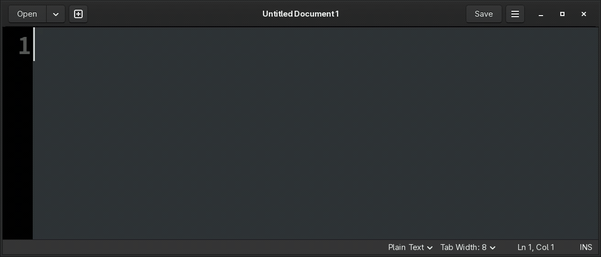
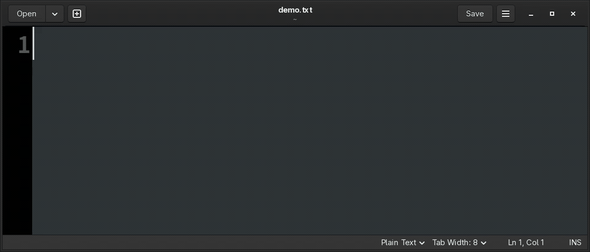

# tgskk

ローカルAIを用いた変換候補順位入れ替え機能付きのSKKです。

[Zenz](https://huggingface.co/Miwa-Keita/zenz-v3.2-small-gguf)が文脈に合う辞書候補を優先します。

[](docs/media/demo.mp4)

AIの応答を待たずに変換できます。

[](docs/media/typing-fast.mp4)

<sub>geditでの実動作を録画しています。</sub>

Linuxのfcitx5 / IBusに対応しています。
[Windows版](addons/windows/README.md)はまだ検証中で、正常に動作せず使えない場合があります。
ローカル辞書に候補がない読みは、同梱の[Google IME SKK server](https://github.com/yoshitsugu/google-ime-skkserv-rs)で補います。
既定で有効です。外部へ読みを送信したくない場合は`SkkservMode=Disabled`で無効にできます。

## インストール

[Releases](https://github.com/yoshitsugu/tgskk/releases)から取得できます。
導入手順は[Linux用パッケージ](docs/distribution.md#インストール)、[Windows版](addons/windows/README.md)を参照してください。
IBus版のソースビルドは[IBusガイド](docs/ibus.md)に記載しています。

辞書・文脈補助・SKK serverの設定、復旧手順、CLIの使い方は[利用ガイド](docs/usage.md)を参照してください。

## 開発

静的検査とテストを実行し、fcitx5版をビルドしてテストします。

```sh
bash scripts/check.sh
bash scripts/check-fcitx5.sh
```

- [速度回帰検査](benchmarks/README.md)
- [設計](docs/architecture.md)
- [CSKKの取り込み情報](third_party/cskk/UPSTREAM.md)

## ライセンス

[GPL-3.0-or-later](LICENSE)。CSKKの著作権情報は[LICENSE.txt](third_party/cskk/LICENSE.txt)と[README](third_party/cskk/README.md)、モデルと推論runtimeの出典・ライセンスは[NOTICE](native/zenz/NOTICE.md)に記載しています。
同梱するGoogle IME SKK serverの出典とライセンスは[取り込み情報](third_party/gskkserv/UPSTREAM.md)を参照してください。
