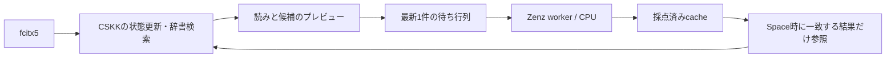

# tgskkの設計

## SKKとZenzの役割

利用者が変換対象の範囲と読みを指定し、CSKKが辞書検索、候補選択、確定と学習を処理する。
Zenzは既存候補の条件付き対数尤度を計算し、明確な差がある場合だけ第一候補を昇格させる。
候補の生成、変換範囲の変更、確定済み文章の書き換えは行わない。

AIの介入を小さくするため、比較するのは上位8候補までとし、第一候補の昇格以外では元の相対順を維持する。
ユーザー辞書にしか存在しない候補は、その位置を変えない。
通常辞書にも存在する学習語は、別の文脈で誤った選好を固定しないよう採点の対象にする。
送り仮名付き変換や英数字を含む表記は、辞書順で扱う。
全候補の採点で最上位と2位のスコア差が1.5未満の場合も順序を変えない。
最上位が保護対象の場合も、別の候補を繰り上げずに辞書順を維持する。
この閾値は介入を控えるための基準であり、モデルの確率を校正した確信度ではない。
KV cacheの再利用状態による数値差で、閾値付近の昇格判定が変わる場合がある。

第一候補が変わった変換をそのまま確定しても、通常の候補順には学習しない。
利用者が候補を明示的に選び直したときは通常の学習に戻す。
Spaceによる巡回途中の候補を否定例として記録しない。

## 入力処理と先読み

▽で入力を始めた時点から、読みと左文脈を先読みする。
候補が0件の依頼も、左文脈と入力途中の読みをKVへ先に載せるために用いる。
この依頼では候補の採点や生成を行わず、同じ読みへの重複依頼はcacheで省く。
保留中の`n`はSpaceと同じかな変換規則で読み取り専用に確定し、先読みの読みを実際の変換と一致させる。
モデルロード、プロセス起動、IPC、推論は専用スレッドで行う。
入力スレッドは`try_lock`で依頼やcacheの参照を行い、競合時には通常変換へ戻る。
Spaceを押した時点で結果がなければ、待たずに辞書と学習の順序を表示する。
候補表示後に結果が届いても、その候補一覧は変更しない。

待ち行列は最新1件、採点結果cacheは16件までとする。
cacheの照合にはセッション世代、左文脈、読み、候補の表記と注釈、保護する位置を含める。
文脈変更、reset、フォーカス移動、Zenz設定変更で世代を変え、処理中の古い結果を破棄する。
モデルの変更時はworkerを作り直す。

## 推論runtime

llama.cppを静的リンクした`tgskk-zenz-worker`を、fcitx5 engine内で共有する。
入力欄ごとにモデルを読み込まない。
通信は継承したUnix socketによる長さ付きバイナリ形式で、TCPやHTTPの待受けは使わない。
握手にはプロトコル版を含め、版が異なるworkerとは通信しない。
入力のトークン数上限などで要求が拒否された場合は、その変換だけ辞書順に戻し、workerは次の要求を処理する。
文字列長、候補数、読書き時間に上限を設け、異常終了や期限切れでは辞書順へ戻る。
モデルロードには5秒、各読書きには500msの上限がある。
これは背景処理の障害検出用であり、入力を待たせる期限ではない。
一時的な通信障害では子プロセスを破棄し、1秒・2秒・4秒・15秒と待機を延ばし、以後は30秒間隔で再起動を続ける。
連続4回の失敗から待機中は利用不能を表示し、採点成功後は失敗回数と待ち時間を戻す。
再起動時も待ち行列は最新1件だけを維持し、世代が有効な失敗依頼だけを再試行する。
モデルや実行ファイルの欠落、権限エラー、不正なプロトコルは再試行せず、入力本文を含まない理由をホストへ返す。
workerのpanicでも利用不能状態に移行する。
CPU推論用のthread poolを使い回し、待機中はspinせず休止する。
推論thread数は論理CPU数の半分、最大4とする。
addonは`NODELETE`でロード後のコードをプロセス終了まで保持し、停止処理中のRustスレッドが実行中に`dlclose`でコードを解放されないようにする。

Zenz v3のタグ形式で左文脈とカタカナの読みを渡し、各候補のトークンをteacher forcingで採点する。
候補末尾のEOSは採点しない。
EOSを含めると、文章の途中で使う正しい単語まで「ここで文章が終わらない」という理由で不利になるためである。
共通するprompt prefixのKV cacheを再利用し、候補ごとの評価後は候補部分だけを除去する。
改行を除き、空白を全角にする前処理はazooKeyの実装に合わせている。
入力文字列中のU+EE00〜U+EE0Fはpromptの制御タグと衝突するため、文脈から除去し、それを含む候補は採点対象にしない。
固定revisionと配布物のSHA256はセットアップスクリプトで検証する。

## 文脈と入力欄

fcitx5の周辺文字列からカーソル左側だけを取り、Zenzへ渡す文脈を最大40文字に制限する。
アプリからの周辺文字列の通知が遅れている間は、tgskk自身の確定文字を補う。
周辺文字列が得られない場合も、同じ入力欄での確定文字を文脈に使える。
フォーカスを失ったとき、reset時、未処理キーがアプリへ渡ったときは補助文脈を破棄する。
password、sensitive、disable属性または選択範囲のある入力欄ではZenzに依頼しない。
文脈はメモリ内だけに保持し、workerの通常ログに入力内容を残さない。

アプリへの確定、候補クリックや数字キーによる確定、フォーカス移動後の状態破棄は同じCSKK sessionを通す。
候補の世代はengine全体で一意にし、別の入力欄で作った候補による確定を防ぐ。
候補UIはAquaSKKの既定に合わせ、最初の4候補をインラインで表示し、5候補目から一覧を出す。
`InlineCandidates`で一覧を出す前の候補数を指定し、0なら最初から一覧、3ならfcitx5-cskkの既定と同じタイミングになる。
一覧にはインラインで通過した候補を含めず、表示上のindexとCSKKの候補indexをoffsetで対応させる。
一覧中のSpaceとxはページ移動になり、先頭ページから戻ると最後のインライン候補へ戻る。
最後のページでSpaceを押すと辞書登録へ進む。
インライン中は`AI-ranked`を含む補助行を表示せず、補助行だけで候補窓が開かないようにする。
モード変更はfcitx5の一時ポップアップで通知し、表示位置と表示期間はUIに従う。

## 辞書と計測

入力用辞書はCSKKのメモリ上の検索を使う。
ユーザー辞書の保存はfcitx5の保存フックで行い、キーイベント内では書き込まない。
一時ファイルを書き終えてから置き換え、直前の内容を`.BAK`へ残す。

`check-zenz.sh`は実モデルの採点と、打鍵間隔を変えた先読みの命中率を測る。
採点の精度、候補順への介入率、結果の準備が間に合った割合、Space処理時間を区別する。
Rust側の測定にはCSKKの処理と先読み依頼を含むが、実アプリの描画やディスプレイへの表示時間は含まない。
実デスクトップでの入力遅延は別に計測する必要がある。

## SKK serverとの接続方針

オンライン候補追加には、[google-ime-skkserv-rs](https://github.com/yoshitsugu/google-ime-skkserv-rs)を別プロセスとして同梱し、既定で有効、設定で無効にできる構成を想定する。
hostとportを指定して別のSKK serverにも接続できるようにする。
通信文字コードは接続先ごとにEUC-JPまたはUTF-8を明示する。
読みだけをserverへ送り、Zenz用の左文脈は送らない。
キー入力処理では応答を待たず、表示後の候補集合も固定する。
この接続はZenz用のローカル通信とは独立させる。
